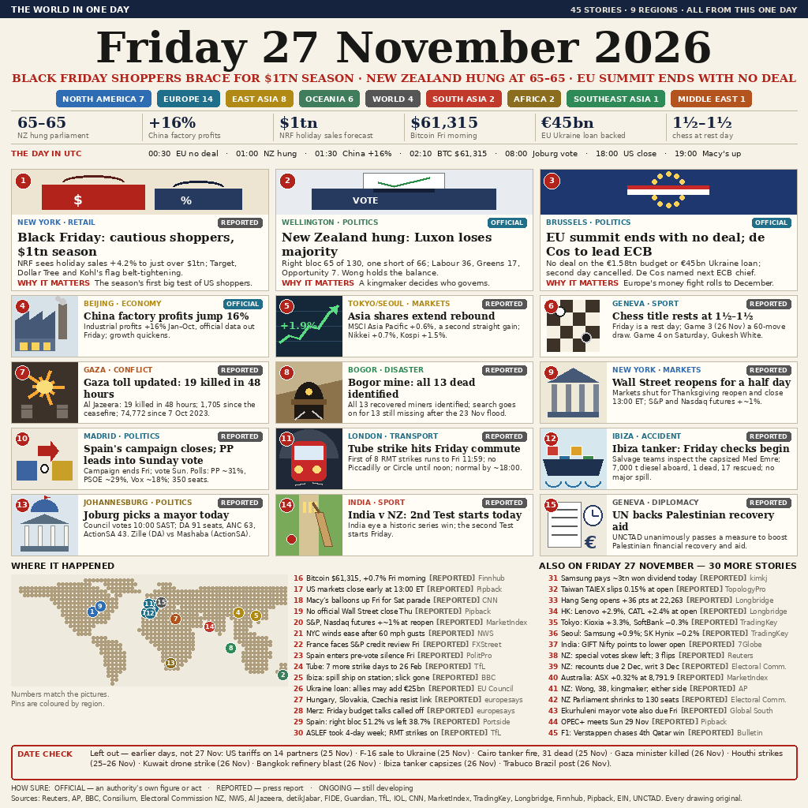

# The World in One Day — Friday, 27 November 2026

[](https://make.fun/bounty/news-image-20261127)
[](https://make.fun/bounty/news-image-20261127)
[](https://make.fun/bounty/news-image-20261127)

One image that sums up the world's news of **Friday 27 November 2026**:
**45 stories across 9 regions**, every one of them an event that happened
or was first reported on that day.



## What is on the page

- **Masthead** — the date, a red subhead with the three biggest stories
  (Black Friday shoppers brace for a $1tn season · New Zealand hung at
  65–65 · EU summit ends with no deal), and region chips whose counts sum
  to 45.
- **The Day in Numbers** — 65–65 NZ hung parliament · +16% China factory
  profits · $1tn NRF holiday sales forecast · $61,315 Bitcoin · €45bn EU
  Ukraine loan backed · 1½–1½ chess at rest day.
- **The Day in UTC** — a timeline from the 00:30 EU summit ending with no
  deal to the 19:00 Macy's balloons going up.
- **15 drawn cards** — three heroes (Black Friday, the hung New Zealand
  parliament, the EU summit ending with no deal) and twelve more, each
  with a small original illustration, a status tag and its source.
- **Also on Friday 27 November** — 30 more one-line stories, each
  labelled REPORTED with its source.
- **Where it happened** — a dotted world map with numbered pins for the
  fifteen cards.
- **Date check** — the big stories deliberately left out because they
  happened on earlier days: the US tariffs on 14 partners, the F-16 sale
  to Ukraine, the Cairo tanker fire, the Gaza deputy minister killed,
  the Houthi strikes, the Kuwait drone strike, the Bangkok refinery
  blast, the Ibiza tanker capsizing, Trabuco taking the Brazil post and
  the ICJ Myanmar ruling.

## How sure

Every story carries one label, explained in the footer:

- **OFFICIAL** — an authority's own figure or act
- **REPORTED** — a press report
- **ONGOING** — still developing

Claims are attributed to whoever made them (the NRF, the Electoral
Commission, Al Jazeera) and never stated as bare fact. Figures were
checked against a wire or primary source before drawing: Reuters, AP,
BBC, Consilium, Electoral Commission NZ, NWS, Al Jazeera, detikJabar,
FIDE, Guardian, TfL, IOL, CNN, MarketIndex, TradingKey, Longbridge,
Finnhub, Pipback, EIN and UNCTAD.

## How it is built

`draw.py` draws the whole page with Pillow and the DejaVu fonts — no
network, no clock, no randomness, so every run writes the same bytes.
`main.ts` copies the committed `entry.png` to the output directory.

```sh
python3 draw.py            # writes entry.png (1024x1024, < 1 MiB)
mkdir -p out && MAKEFUN_OUTPUT_DIR=out node main.ts
```

Entry for the make.fun competition
[news-image-20261127](https://make.fun/bounty/news-image-20261127)
— "Sum up 27 November's world news in one image".

## License

MIT — see [LICENSE](LICENSE).
